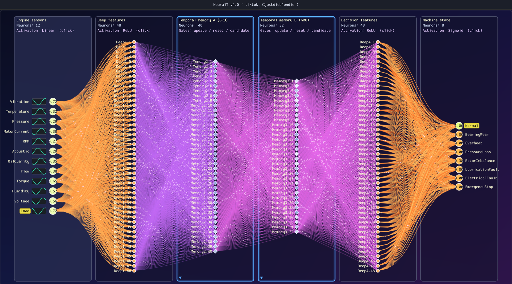

# NeuralT

NeuralT is a neural-network editor with an ImGui-based graphical interface.



## What's new in v4.0

- **GRU memory layers.** Any hidden layer can be a GRU (press `G` on the selected hidden layer, or click its
  activation line until it reads `GRU`). A GRU layer has update/reset/candidate gates and keeps its hidden
  state from frame to frame, so it smooths and remembers recent inputs. Its candidate input weights are the
  drawn edges; the gate weights are saved in a `recurrent` section of the network file. Training uses
  one-step truncated backprop: each lesson starts from an empty memory and runs 3 steps on its input.
- **Engine Sensor example** (`saved/engine_sensor_gru.json`, opened at startup). It's an MLP + GRU network:
  12 sensors (Vibration, Temperature, Pressure, ...) -> Deep features (48, ReLU) -> Temporal memory A
  (GRU, 40) -> Temporal memory B (GRU, 32) -> Decision features (48, ReLU) -> Machine state (8, Sigmoid:
  Normal, BearingWear, Overheat, PressureLoss, RotorImbalance, LubricationFault, ElectricalFault,
  EmergencyStop). It comes pre-trained on its 112 lessons.
- GRU panels have a blue frame and diamond-shaped neurons. Edges into and out of a memory are drawn in
  violet/magenta with particles travelling along them. There's a new `Ignition` theme (Shift+T cycles themes).
- **Presentation mode** (on at startup, `P` toggles it): the graph fills the screen with only the title on
  top. Connections sway continuously. The sensor and output fans curve into an hourglass, and the memory
  layers form a glowing lattice. `=`/`-`/`0` zoom in, zoom out and fit. Ctrl/Cmd+wheel zooms at the cursor,
  right-drag pans, and `C` toggles a slow camera drift.
- `./neuralT --pretrain <file.json> [maxEpochs]` trains a network file's lessons until its target MSE
  and saves the result back to the file.

## Requirements (Linux)

- `g++` compiler with C++17 support;
- GLFW;
- GLEW;
- OpenGL;
- X11 system libraries: `dl`, `pthread`, `Xrandr`, `Xi`, and `m`.

The project also requires an `imgui/` directory containing ImGui sources and the GLFW/OpenGL3 backends.

## Build

Run the following command from the project directory:

```bash
g++ -std=c++17 -O2 -Wall -Wextra main.cpp \
  imgui/imgui.cpp imgui/imgui_draw.cpp imgui/imgui_tables.cpp imgui/imgui_widgets.cpp \
  imgui/backends/imgui_impl_glfw.cpp imgui/backends/imgui_impl_opengl3.cpp \
  -Iimgui -Iimgui/backends -DUSE_IMGUI -DIMGUI_IMPL_OPENGL_LOADER_GLEW \
  -lglfw -lGLEW -lGL -ldl -lpthread -lX11 -lXrandr -lXi -lm -o neuralT
```

## Build (macOS)

No Homebrew packages are needed. GLFW, GLEW and ImGui are compiled from source:

```bash
git clone --depth 1 https://github.com/ocornut/imgui.git imgui
mkdir -p third_party && cd third_party
git clone --depth 1 --branch 3.4 https://github.com/glfw/glfw.git
curl -sL https://github.com/nigels-com/glew/releases/download/glew-2.2.0/glew-2.2.0.tgz | tar xz
cd ..
make -f Makefile.macos -j8
```

## Run

After a successful build, start the application with:

```bash
./neuralT
```

The Engine Sensor GRU example opens at startup. Press 'o' to load another network, such as the Neuro NPC example, and F5 for more info. 
